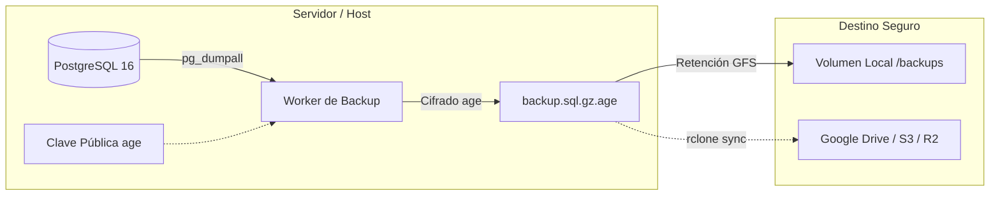

# 🚲 Tandem — Finanzas en Pareja (Couple Finance)

[](https://opensource.org/licenses/MIT)
[](https://www.python.org/)
[](https://fastapi.tiangolo.com/)
[](https://www.postgresql.org/)
[](https://www.docker.com/)
[](https://aistudio.google.com/)

[English](#english) | [Español](#español)

---

<a name="english"></a>
## 🇬🇧 English

**Tandem** is a shared domestic accounting and financial management web application built for couples and modern households.

It features a **Dual UI** (Mobile-First Simple View and Desktop Full Mode), append-only immutable auditing, native dual-currency management, **AI Assistant with Voice Dictation (Google Gemini + Web Speech API)**, and automated encrypted daily backups using `age` with Grandfather-Father-Son (GFS) retention.

---

### 🌟 Key Architectural Features

- **Strict Banking Precision:** All monetary calculations use Python `Decimal` with `ROUND_HALF_UP`. Floating-point math is strictly forbidden.
- **Immutable Audit Trail:** Deletions and reversals are strictly logged in an append-only `audit_log` with user attribution and reason.
- **Dual UI Experience:**
  - **Simple Mode (390px Mobile-First):** Lightning-fast daily expense logging, instant balance checks, and speech-to-text input.
  - **Full Mode:** Credit card reconciliation, balance carryovers, formal monthly closes, and analytics.
- **AI Voice Assistant:** Natural language parsing of receipts, tickets, and informal messages via Google Gemini with automated duplicate detection.
- **Zero-Setup Onboarding Wizard:** Self-contained `/setup` wizard on first run to configure partners, household currency, split ratios, and default accounts.
- **Homelab Ready:** Production-grade `docker-compose.yml` with least-privilege PostgreSQL roles and automated encrypted off-site backups via `age` and `rclone`.

---

### ⚡ Quickstart with Docker

```bash
# 1. Clone the repository
git clone https://github.com/Rcarme/tandem.git
cd tandem

# 2. Configure environment
cp .env.example .env
# Edit .env and set APP_SECRET_KEY and PostgreSQL passwords

# 3. Launch with Docker Compose
docker compose up -d

# 4. Open in your browser
# Visit http://localhost:8088 to complete the Onboarding Wizard
```

---

<a name="español"></a>
## 🇦🇷 Español

**Tandem** es una plataforma web completa de contabilidad doméstica compartida, diseñada específicamente para parejas y hogares que desean transparencia financiera, equidad y simplicidad en el día a día.

Incluye una **UI dual** (Modo Simple Mobile-First y Modo Completo de escritorio), contabilidad inmutable basada en partida doble simplificada, soporte bimonetario nativo, **asistente de IA con dictado por voz (Google Gemini + Web Speech API)** y un sistema de **backups automáticos cifrados con age** bajo esquema de rotación abuelo-padre-hijo (GFS).

---

### ✨ Fortalezas y Características Principales

1. **Contabilidad Robusta y Auditoría Inquebrantable:**
   - **Cero errores de redondeo:** Todo importe monetario se almacena y calcula estrictamente en `Decimal` con redondeo estándar bancario (`ROUND_HALF_UP`). Prohibido el uso de flotantes (`float`).
   - **Nada se borra contablemente:** Las anulaciones y correcciones se registran con motivo y usuario en una bitácora inmutable append-only (`audit_log`).
   - **Fondos y Titularidad:** Soporte para fondos comunes compartidos, dinero particular de cada integrante y tarjetas de crédito con titulares y extensiones.
   - **Soporte Bimonetario Nativo:** Gestión en la moneda local de su país (ARS, EUR, USD, MXN, CLP, COP, etc.) y dólares estadounidenses (USD) para ahorros y compromisos a largo plazo.

2. **UI Dual (Diseñada para Teléfono y Escritorio):**
   - **Modo Simple (Mobile-First):** Optimizado para pantallas móviles (390 px). Carga ultrarrápida de gastos en la calle, consulta de saldos en segundos y filtros rápidos.
   - **Modo Completo:** Conciliación de resúmenes de tarjetas, arrastre de saldos, cierres mensuales formales y reportería analítica avanzada.

3. **Asistente de Inteligencia Artificial con Voz (Google Gemini):**
   - **Carga en lenguaje natural:** Pegá un texto de compra, ticket de supermercado o resumen. La IA desglosa productos, detecta destinatarios y sugiere cuentas y categorías.
   - **Detección inteligente de duplicados:** Alerta antes de guardar si ya existe un gasto con el mismo monto y fecha.
   - **Dictado por voz integrado:** Botón de micrófono con Web Speech API para dictar gastos directamente desde el teléfono sin escribir.
   - **Clave opcional:** Podés usar la aplicación sin IA o activar Gemini ingresando tu API key gratuita durante el asistente de inicio o desde Ajustes.

4. **Asistente de Configuración Inicial (Onboarding Wizard):**
   - Si la base de datos está vacía, el sistema redirige automáticamente a `/setup`.
   - Permite dar de alta a la **Persona 1** y **Persona 2**, elegir la moneda principal, definir la regla de reparto (50/50 o proporcional) y sembrar automáticamente las categorías y cuentas recomendadas.

5. **Infraestructura y Backups Cifrados:**
   - Despliegue con un solo comando: `docker compose up -d`.
   - Separación estricta de privilegios de base de datos (`finanzas_bootstrap`, `finanzas_owner`, `finanzas_app`).
   - Contenedor de backup diario con cifrado criptográfico moderno (`age`), verificación de integridad y sincronización opcional con Google Drive / S3 mediante `rclone`.

---

### 🚀 Guía Rápida de Despliegue (Quickstart)

#### Requisitos Previos
- [Docker](https://docs.docker.com/get-docker/) y [Docker Compose](https://docs.docker.com/compose/) instalados.

#### 1. Clonar el repositorio
```bash
git clone https://github.com/Rcarme/tandem.git
cd tandem
```

#### 2. Configurar variables de entorno
Copiá el archivo de ejemplo:
```bash
cp .env.example .env
```
Abrí `.env` con tu editor preferido y completá:
- `APP_SECRET_KEY`: Generá una clave aleatoria segura ejecutando `openssl rand -hex 32`.
- `POSTGRES_ADMIN_PASSWORD`, `POSTGRES_OWNER_PASSWORD`, `POSTGRES_APP_PASSWORD`: Definí contraseñas seguras (mínimo 12 caracteres).
- `GEMINI_API_KEY` *(Opcional)*: Tu clave de API de Google Gemini (también podés ingresarla más adelante desde la web).

#### 3. Iniciar los contenedores
```bash
docker compose up -d
```

#### 4. Primer ingreso y Asistente Inicial
1. Abrí tu navegador en `http://localhost:8088`.
2. El sistema detectará que es la primera ejecución y te llevará al **Asistente de Bienvenida (`/setup`)**.
3. Ingresen los nombres de usuario y contraseñas de la pareja, elijan su moneda local y ¡listo! Ya pueden comenzar a registrar sus finanzas.

#### 🧪 Carga Rápida de Datos Demo (Entorno de Desarrollo)
Si estás probando localmente y querés sembrar datos ficticios sin configurar todo a mano:
```bash
python scripts/seed_demo.py
```
*(Bloqueado estrictamente en producción. Genera contraseñas aleatorias seguras impresas en consola al momento de la ejecución).*

---

### 🛡️ Despliegue con Reverse Proxy (Caddy / Nginx / Tailscale)
Para acceder de forma segura desde fuera de tu hogar o desde teléfonos móviles con HTTPS:
1. Mantené la aplicación vinculada a `127.0.0.1:8088` (`APP_BIND_ADDRESS=127.0.0.1`).
2. Configurá tu proxy inverso (ej: Caddy o Nginx) para terminar TLS y enviar cabeceras `X-Forwarded-For` y `X-Forwarded-Proto`.
3. En tu `.env`, asegurate de configurar `FORWARDED_ALLOW_IPS` con la IP del proxy (por defecto `127.0.0.1`).
4. Si exponés el puerto en una red pública antes del setup, definí `SETUP_TOKEN=tu-clave-secreta` en `.env` para bloquear el asistente inicial contra terceros no autorizados.

#### Ejemplo de Caddyfile
```caddy
finanzas.tu-dominio.com {
    reverse_proxy 127.0.0.1:8088
}
```

---

### 📦 Arquitectura de Backups Cifrados (GFS)



La clave privada de `age` **nunca se almacena en el servidor**, garantizando que incluso ante una vulneración del servidor o del almacenamiento en la nube, los datos financieros no puedan ser leídos por atacantes.

---

### 🔑 Cómo Obtener tu API Key Gratuita de Google Gemini

1. Ingresá a [Google AI Studio](https://aistudio.google.com/app/apikey) con tu cuenta de Google.
2. Hacé clic en **"Create API key"**.
3. Copiá la clave generada.
4. Pegala en el Asistente Inicial (`/setup`), en la sección **Ajustes** dentro de la app, o en la variable `GEMINI_API_KEY` de tu archivo `.env`.

---

### 🤝 Comunidad y Documentación / Community & Docs

- **Arquitectura y Modelo Contable:** [ARCHITECTURE.md](ARCHITECTURE.md)
- **Manual de Operaciones y Backups:** [docs/RUNBOOK.md](docs/RUNBOOK.md)
- **Guía de Contribución:** [CONTRIBUTING.md](CONTRIBUTING.md)
- **Política de Seguridad:** [SECURITY.md](SECURITY.md)
- **Código de Conducta:** [CODE_OF_CONDUCT.md](CODE_OF_CONDUCT.md)
- **Hoja de Ruta (Roadmap):** [ROADMAP.md](ROADMAP.md)

---

### 📄 Licencia / License

Distribuido bajo la licencia **MIT**. Consultá el archivo [LICENSE](LICENSE) para más detalles.  
Distributed under the **MIT License**. See [LICENSE](LICENSE) for details.
